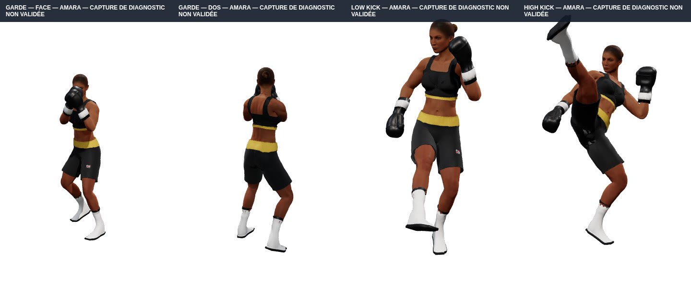
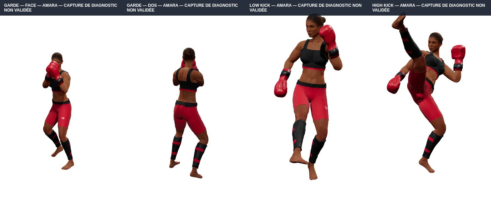
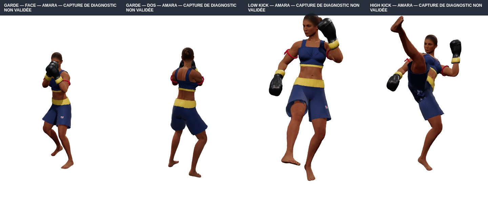
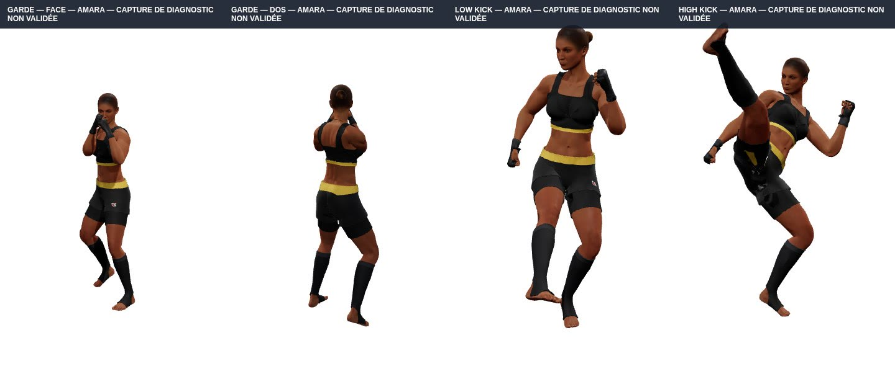
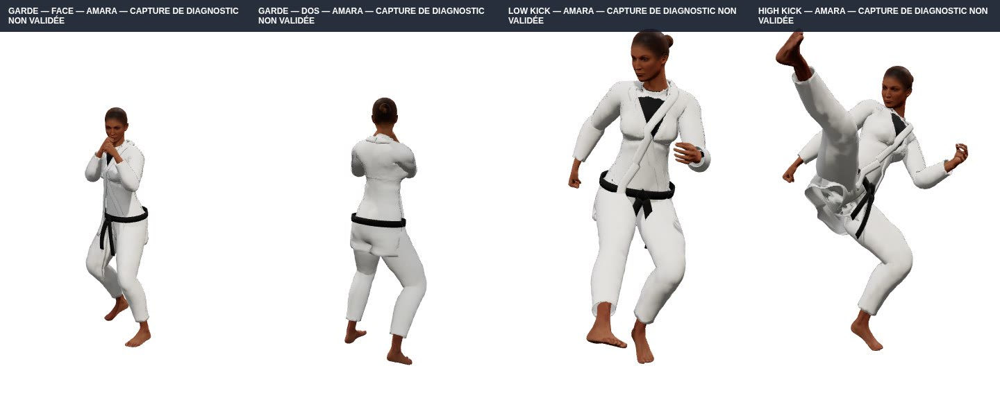
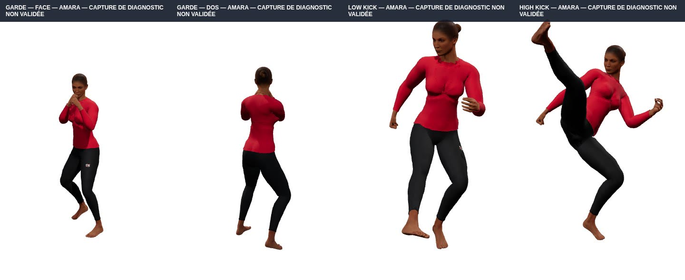
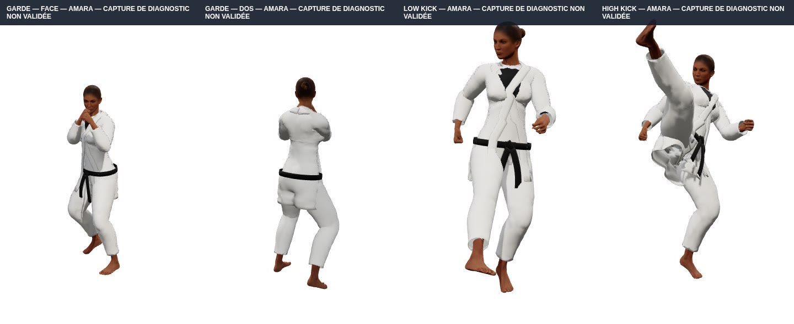

# Amara — revue visuelle des 7 tenues (v1.37.9)

**Date : 12 novembre 2026.** Captures réelles de l'application React/Three.js, générées avec Playwright sur la branche non publiée `fix/amara-garment-finish-v1379` (corrections de matières uniquement).

**IMPORTANT — NON VALIDÉ.** Le corps d'Amara conserve des traces géométriques de son ancien bikini ; l'audit des masques des sept tenues détecte encore des triangles d'origine dessinés. Ces planches sont un outil **pour signaler les défauts**, pas une preuve de leur correction. Ne pas fusionner ni déployer en l'état.

Chaque bande a quatre vues : **garde face**, **garde dos**, **low kick**, **high kick**. Tous les modèles portent leur tenue réelle et les animations du moteur. Les coups de pied dans les tenues JJB et judo sont exclusivement un stress-test du tissu.

**À vérifier sur chaque vue** : anciennes bretelles/bonnets, ligne du décolleté, plis hérités du maillot de base, trous, contours d'emmanchures, bande dorsale, coutures, peau traversant le textile, piques à l'entrejambe pendant le kick.

## Boxe

[**Ouvrir la planche de Boxe en grand**](./amara-boxe.jpg)

Grossir individuellement : [garde face](./amara-boxe-garde-face.jpg) · [garde dos](./amara-boxe-garde-dos.jpg) · [low kick](./amara-boxe-low-kick.jpg) · [high kick](./amara-boxe-high-kick.jpg)

## Kick-boxing

[**Ouvrir la planche de Kick-boxing en grand**](./amara-kickboxing.jpg)

Grossir individuellement : [garde face](./amara-kickboxing-garde-face.jpg) · [garde dos](./amara-kickboxing-garde-dos.jpg) · [low kick](./amara-kickboxing-low-kick.jpg) · [high kick](./amara-kickboxing-high-kick.jpg)

## Muay-thaï

[**Ouvrir la planche de Muay-thaï en grand**](./amara-muaythai.jpg)

Grossir individuellement : [garde face](./amara-muaythai-garde-face.jpg) · [garde dos](./amara-muaythai-garde-dos.jpg) · [low kick](./amara-muaythai-low-kick.jpg) · [high kick](./amara-muaythai-high-kick.jpg)

## MMA

[**Ouvrir la planche de MMA en grand**](./amara-mma.jpg)

Grossir individuellement : [garde face](./amara-mma-garde-face.jpg) · [garde dos](./amara-mma-garde-dos.jpg) · [low kick](./amara-mma-low-kick.jpg) · [high kick](./amara-mma-high-kick.jpg)

## JJB

[**Ouvrir la planche de JJB en grand**](./amara-bjj.jpg)

Grossir individuellement : [garde face](./amara-bjj-garde-face.jpg) · [garde dos](./amara-bjj-garde-dos.jpg) · [low kick](./amara-bjj-low-kick.jpg) · [high kick](./amara-bjj-high-kick.jpg)

## JJB no-gi

[**Ouvrir la planche de JJB no-gi en grand**](./amara-bjj-nogi.jpg)

Grossir individuellement : [garde face](./amara-bjj-nogi-garde-face.jpg) · [garde dos](./amara-bjj-nogi-garde-dos.jpg) · [low kick](./amara-bjj-nogi-low-kick.jpg) · [high kick](./amara-bjj-nogi-high-kick.jpg)

## Judo

[**Ouvrir la planche de Judo en grand**](./amara-judo.jpg)

Grossir individuellement : [garde face](./amara-judo-garde-face.jpg) · [garde dos](./amara-judo-garde-dos.jpg) · [low kick](./amara-judo-low-kick.jpg) · [high kick](./amara-judo-high-kick.jpg)

## Diagnostic technique

Les captures sont accompagnées du [rapport automatique de pose et chargement](./diagnostic.json). Les nombres bruts de triangles étirés dans ce rapport ne constituent pas, à eux seuls, une mesure fiable des défauts visuels ; les captures et la vidéo de mouvement restent indispensables.

Génération : `scripts/dev/capture-amara-review-v1379.mjs`, workflow `.github/workflows/amara-review-sheets-v1379.yml`. Le déclenchement automatique n'entraîne aucun déploiement.
